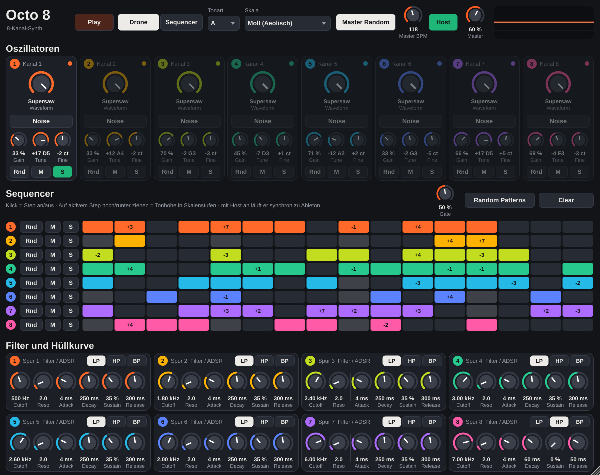

# Octo8 – 8-Kanal-Synthesizer (VST3 / AU) für macOS & Ableton

**[⬇ Download für macOS (Octo8-macOS.zip)](https://github.com/donkirschbaum/CLAUDE/releases/download/octo8-latest/Octo8-macOS.zip)**



## Funktionen
- **8 Oszillator-Kanäle** mit 21 Wellenformen: Sine, Triangle, Square, Sawtooth, Reverse Saw, Pulse 25 % / 12,5 % / 5 %, Half-Sine, Rectified Sine, Trapezoid, Stepped 4-bit, Parabolic, Sine Fold, Sync Saw, Organ, Odd Harmonics, Bell, Vocal Ah, Brass, Supersaw (bandbegrenzte Wavetables, kein Aliasing)
- **Noise-Button je Kanal**: verwandelt den Waveform-Regler in einen Rauschart-Wähler – White, Pink, Brown, Blue, Violet, Grey, Velvet, Crackle, Digital S&H
- Je Kanal **Gain, Tune (±24 HT mit Notenanzeige), Finetune (±100 ct), Random, Mute, Solo**
- **Tonart + Skala** (18 Skalen); **Master Random** und Kanal-Random würfeln nur Töne aus der Skala, Tonartwechsel quantisiert automatisch
- **16-Step-Sequencer** für alle 8 Spuren mit Random/Mute/Solo je Spur, Tonhöhe pro Step in Skalenstufen (auf Step ziehen), Gate-Länge
- **Master BPM + Host-Button**: Host an = Tempo und Start/Stop kommen von Ableton (BPM-Regler zeigt das Host-Tempo); Host aus = eigenes Master-BPM, Start mit Play
- **Drone-Modus**: alle Kanäle klingen dauerhaft (Play, Host-Transport oder gehaltene MIDI-Note)
- MIDI-Noten transponieren alles relativ zu C3
- Je Spur **Filter (LP/HP/BP, Cutoff, Resonanz)** und **ADSR-Hüllkurve**
- Alle Parameter automatisierbar, Pattern werden im Ableton-Set gespeichert, skalierbares Fenster

## Installation
1. [Octo8-macOS.zip](https://github.com/donkirschbaum/CLAUDE/releases/download/octo8-latest/Octo8-macOS.zip) laden und entpacken
2. Rechtsklick auf **Install.command** → *Öffnen* (falls blockiert: Systemeinstellungen → Datenschutz & Sicherheit → *Trotzdem öffnen*)
3. Ableton neu starten → Einstellungen → Plug-Ins → *Neu scannen*

Das Plugin ist ad-hoc signiert, aber nicht notarisiert. Alternativ per Terminal:
```bash
cp -R Octo8.vst3 ~/Library/Audio/Plug-Ins/VST3/
cp -R Octo8.component ~/Library/Audio/Plug-Ins/Components/
xattr -dr com.apple.quarantine ~/Library/Audio/Plug-Ins/VST3/Octo8.vst3 ~/Library/Audio/Plug-Ins/Components/Octo8.component
```

## Selbst bauen
```bash
cd Octo8
cmake -B build -DCMAKE_BUILD_TYPE=Release "-DCMAKE_OSX_ARCHITECTURES=arm64;x86_64"
cmake --build build --config Release -j
```
Benötigt CMake ≥ 3.22 und Xcode. JUCE wird automatisch geladen. Jeder Push auf `Octo8/` baut über GitHub Actions und aktualisiert das Release `octo8-latest`.

## Lizenz
AGPL-3.0 (gebaut mit dem [JUCE Framework](https://juce.com) unter dessen AGPLv3-Lizenz).
