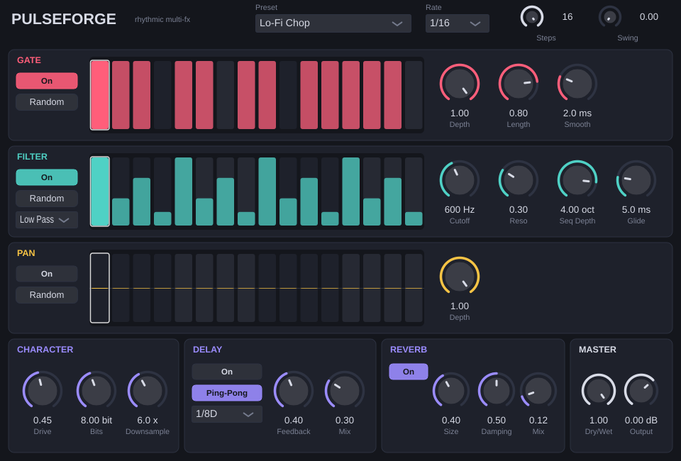

# PulseForge

Rhythmischer, tempo-synchroner Multi-Effekt für Ableton Live (und jede andere DAW) auf dem Mac –
**Audio Unit + VST3 + Standalone, Universal Binary (Apple Silicon & Intel)**.



## Download

Fertige Builds: **[Releases](https://github.com/donkirschbaum/CLAUDE/releases?q=pulseforge)** → Release `pulseforge-v…`

- **`PulseForge-…-macOS.pkg`** (empfohlen): Rechtsklick → *Öffnen* → installiert AU + VST3 nach `/Library/Audio/Plug-Ins/`
- **`PulseForge-…-macOS.zip`**: entpacken → Rechtsklick auf `Install.command` → *Öffnen* (enthält auch die Standalone-App)

Danach Ableton Live neu starten → Plug-ins → donkirschbaum → PulseForge.

Jeder Push auf den Branch `pulseforge` baut das Plugin automatisch per GitHub Actions auf einem macOS-Runner
und veröffentlicht ein neues Release.

## Features

| Modul | Funktion |
|---|---|
| **Step-Gate** | 16 Steps, Depth, Gate-Länge, Smooth (Klickfreiheit) |
| **Step-Filter** | LP / BP / HP (TPT-SVF), Cutoff, Resonanz, Sequencer-Tiefe ±6 Oktaven, Glide |
| **Step-Pan** | 16 Steps Panorama, Depth |
| **Character** | Drive (tanh-Sättigung), Bitcrusher, Downsampling |
| **Delay** | Tempo-synchron (1/16 … 1/2, triolisch, punktiert), Feedback, Ping-Pong |
| **Reverb** | Size, Damping, Mix |
| **Master** | Dry/Wet, Output |
| **Sequencer** | Rate 1/4 … 1/32 (inkl. Triolen), Länge 1–16, Swing, Random pro Zeile |

Signalfluss: Drive → Crusher → Filter → Gate → Pan → Delay → Reverb → Dry/Wet.

Alle Parameter (inkl. jedes einzelnen Steps) sind in Ableton automatisierbar.
Läuft das Transport, folgt der Sequencer der Song-Position; im Stopp läuft er frei im Projekttempo.

## Selbst bauen

```bash
git clone -b pulseforge https://github.com/donkirschbaum/CLAUDE.git PulseForge
cd PulseForge
cmake -B build -G Xcode -DCMAKE_OSX_ARCHITECTURES="arm64;x86_64" -DPULSEFORGE_BUILD_TESTS=ON
cmake --build build --config Release -j
```

Benötigt CMake ≥ 3.22 und Xcode Command Line Tools. JUCE 8 wird automatisch geladen.
Die fertigen Plugins liegen danach in `build/PulseForge_artefacts/Release/`.

## Tests

`tests/OfflineTest.cpp` rendert alle Presets mit simuliertem 120-BPM-Host-Transport und prüft
NaN/Inf, Pegel und dass das Gate-Pattern exakt auf dem Raster schaltet. Läuft in jedem CI-Build.

## Hinweis

Das Plugin ist nur ad-hoc signiert (nicht notarisiert). Der `.pkg`-Installer umgeht die Quarantäne;
`Install.command` entfernt das Quarantäne-Flag. Für eine Weitergabe an Dritte wäre eine Apple-Developer-ID-Signatur nötig.

Eigenständige Entwicklung, inspiriert vom Konzept rhythmischer Multi-Effekte; kein Code oder Design
von Drittprodukten. JUCE steht unter AGPLv3/kommerzieller Lizenz – für private Nutzung unproblematisch.
