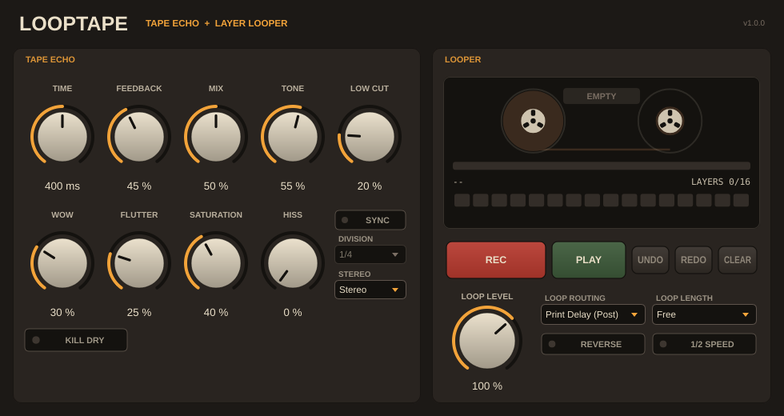

# LoopTape – Tape Echo + Layer Looper

Freies Delay-Plugin (VST3 + Audio Unit) für macOS / Ableton Live: ein warmes **Band-Echo** mit
integriertem **Multi-Layer-Looper**. Jeder Overdub landet auf einer **eigenen Spur (Layer)**, bis zu 16 Stück,
einzeln per Undo/Redo zurücknehm- und wiederherstellbar. Gebaut für den Einsatz in einer **Return-Spur**:
Du schickst Signale aus verschiedenen Spuren rein, das Echo wird mit aufgenommen („gedruckt“), und Schicht für Schicht entsteht ein
Loop-Teppich.



## ⬇️ Download

**[→ Neueste Version herunterladen (Releases)](https://github.com/donkirschbaum/CLAUDE/releases/tag/looptape-v1.0.0)**

| Datei | Wofür |
|---|---|
| `LoopTape-x.y.z-macOS.pkg` | **Empfohlen.** Installer, legt VST3 + AU nach `/Library/Audio/Plug-Ins/` |
| `LoopTape-x.y.z-macOS.zip` | Manuell: Plugins + `Install.command` (installiert für deinen Benutzer) |

Universal Binary (Apple Silicon **und** Intel), macOS 11 oder neuer.

### Installation

1. `.pkg` herunterladen und doppelklicken.
   Das Plugin ist nicht bei Apple notarisiert (kostenloses Open-Source-Projekt). Wenn macOS meldet, dass der
   Installer „nicht geöffnet werden kann“: **Systemeinstellungen → Datenschutz & Sicherheit → ganz unten „Dennoch öffnen“**
   (bei älteren macOS-Versionen reicht Rechtsklick → Öffnen).
2. Ableton neu starten. Unter **Einstellungen → Plug-Ins** muss „VST3-Plug-In-Systemordner verwenden“ bzw. „Audio Units verwenden“ aktiv sein.
3. LoopTape findest du im Browser unter *Plug-Ins → donkirschbaum → LoopTape*.

Falls Ableton das Plugin trotzdem nicht lädt (Quarantäne-Flag), im Terminal:

```bash
sudo xattr -dr com.apple.quarantine /Library/Audio/Plug-Ins/VST3/LoopTape.vst3 /Library/Audio/Plug-Ins/Components/LoopTape.component
```

## Features

**Tape Echo**
- 20 ms – 2,5 s oder **Tempo-Sync** zum Ableton-Tempo (1/32 bis 1/1, triolisch und punktiert)
- Zeitänderungen gleiten wie ein Bandmotor (Pitch-Bend-Effekt statt Knacksen)
- **Wow** (langsames, driftendes Leiern) und **Flutter** (schnelles Flattern)
- **Saturation**: jede Wiederholung läuft durch den „Aufnahmekopf“ und wird wärmer und schmutziger
- **Tone** / **Low Cut** im Feedback-Pfad: Wiederholungen werden dunkler und dünner
- **Feedback bis 110 %**: Selbstoszillation, durch die Bandsättigung trotzdem begrenzt
- **Hiss** (Bandrauschen), **Stereo** oder **Ping-Pong**
- **Kill Dry**: entfernt das Direktsignal (für Return-Spuren)

**Layer Looper**
- bis **60 s** Loop-Länge, bis **16 Layer**
- jeder Overdub = eigener Layer → **Undo / Redo Layer für Layer**
- **Loop Routing**
  - *Print Delay (Post)*: jeder Layer nimmt Eingang **+ Echo** auf. Du kannst zwischen den Layern die
    Delay-Einstellungen ändern, jede Schicht behält ihr eigenes Echo.
  - *Feed Delay (Pre)*: der Loop läuft **durch** das Delay; Delay-Änderungen wirken live auf den ganzen Loop.
- **Loop Length**: *Free*, auf *Beat* oder *Bar* gerundet (nach Ableton-Tempo). Endet die Aufnahme zu früh, nimmt der Looper bis zum nächsten Raster weiter auf.
- **Reverse** und **1/2 Speed** (Oktave tiefer, doppelt so lang)
- Klickfreie Übergänge (Fades an Loop-Naht, Punch-In/Out, Start/Stop, Undo)

## Bedienung des Loopers

| Taste | Leer | Aufnahme | Wiedergabe | Overdub | Gestoppt |
|---|---|---|---|---|---|
| **REC / DUB** | Aufnahme starten | Loop schließen → Wiedergabe | neuen Layer aufnehmen | Overdub beenden | von vorn + Overdub |
| **PLAY / STOP** | – | Loop schließen → Stopp | Stopp | Overdub beenden + Stopp | von vorn abspielen |
| **UNDO** | – | Aufnahme verwerfen | letzten Layer aus | laufenden Take verwerfen | letzten Layer aus |
| **REDO** | | | Layer wieder an | | Layer wieder an |
| **CLEAR** | | alles löschen | alles löschen | alles löschen | alles löschen |

Die Kästchen im Display zeigen die Layer: hell = Basis-Loop, orange = Overdubs, rot blinkend = nimmt gerade auf,
nur umrandet = per Redo wiederherstellbar.

## Workflow: Layer mit Delays in der Return-Spur

1. LoopTape auf eine **Return-Spur** legen (z. B. Return A).
2. **KILL DRY** einschalten, Mix ca. 50–100 %. (Das Direktsignal kommt ja schon aus den Original-Spuren.)
3. **Loop Routing = Print Delay (Post)**.
4. Auf einer Spur den Send A aufdrehen → **REC** → spielen → **REC** schließt den Loop.
5. Delay-Zeit, Feedback, Tone, Wow … verändern, eine andere Spur zum Return schicken → **DUB** → spielen → **DUB**.
6. Wiederholen: jeder Layer hat sein eigenes Echo, gespeichert auf einem eigenen Layer. Gefällt einer nicht, **UNDO**.

> Der Looper nimmt **immer** das Eingangssignal auf, auch mit KILL DRY: Kill Dry entfernt nur das *live* durchgereichte Direktsignal.
> Tipp: *Loop Length = Bar* sorgt dafür, dass der Loop taktgenau zum Ableton-Set passt.

## MIDI-Steuerung / Fußschalter

Alle Looper-Tasten gibt es auch als automatisierbare Parameter (*Looper Rec/Dub, Play/Stop, Undo, Redo, Clear*).
In Ableton: Gerät aufklappen → **Konfigurieren** → Parameter anklicken → MIDI-Map-Modus (Cmd+M) → Taster/Fußschalter drücken.
Ausgelöst wird bei der **steigenden Flanke** (Wert springt von 0 auf 1). Taster daher im Modus „Momentary“ verwenden.

## Hinweise

- Der Loop-Inhalt wird **nicht** im Ableton-Set gespeichert (nur die Einstellungen). Zum Behalten: Return-Spur in eine Audiospur resampeln.
- Speicher: Pro Instanz werden ca. 23 MB (48 kHz) für den Basis-Loop reserviert, Overdub-Layer nach Bedarf in Loop-Länge.

## Selbst bauen

```bash
git clone -b looptape https://github.com/donkirschbaum/CLAUDE.git looptape && cd looptape
cmake -B build -G Xcode -DCMAKE_OSX_ARCHITECTURES="arm64;x86_64"
cmake --build build --config Release
# Ergebnis: build/LoopTape_artefacts/Release/{VST3,AU}
```

JUCE 8 wird automatisch heruntergeladen. Bei jedem Tag `looptape-v*` baut GitHub Actions das Release (inkl. DSP-Tests,
pluginval, auval).

DSP-Tests ohne JUCE: `g++ -std=c++17 -O2 -ISource tests/OfflineTest.cpp -o t && ./t`

## Lizenz & Hinweis

AGPL-3.0 (siehe [LICENSE](LICENSE)), gebaut mit [JUCE](https://juce.com).
Inspiriert von Delay-Pedalen mit Tape-Modus und Looper wie dem TC Electronic Flashback. LoopTape ist eine eigenständige Neuentwicklung,
nutzt weder Code noch Algorithmen von TC Electronic und steht in keiner Verbindung zu TC Electronic.
